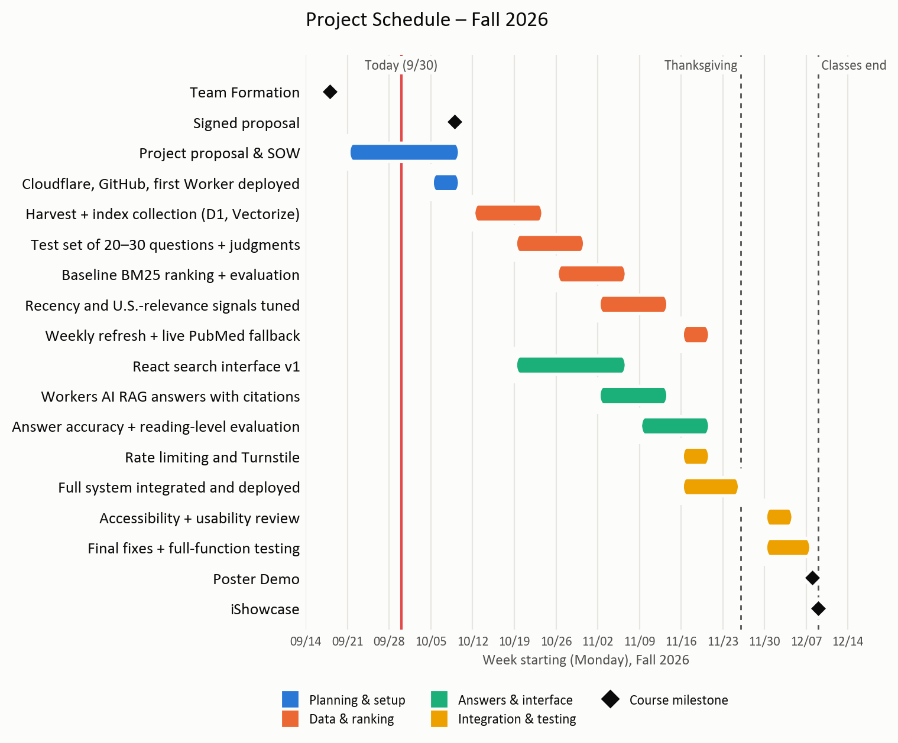

# GenAI Web Application for AI Literacy

**AI Health Literacy: An Aging & Lifestyle Research Explorer**

Project Proposal & Statement of Work

- **Project Manager:** Juan Nadal
- **Team:** Juan Nadal (sole team member)
- **Mentor:** Dr. Xiao Hu
- **Date:** September 30, 2026

> **About this file:** Markdown copy of proposal v1.0, kept in the repository so the project scope is easy to read on GitHub. The signed PDF is the document of record.

## Revision History

| Version | Summary of Changes                                               | Date     |
| ------- | ---------------------------------------------------------------- | -------- |
| 1.0     | Initial proposal and statement of work, submitted for signatures | 09/30/26 |

## Table of Contents

- [1. Executive Summary](#1-executive-summary)
- [2. User/Market Research](#2-usermarket-research)
  - [Overall Market](#overall-market)
  - [Existing Competitors](#existing-competitors)
  - [User Insights](#user-insights)
- [3. Product Features, Skills and Data](#3-product-features-skills-and-data)
  - [System Architecture & API Key Security](#system-architecture--api-key-security)
  - [Feature 1: Patient Search Interface](#feature-1-patient-search-interface)
  - [Feature 2: PubMed Harvest & Index Pipeline](#feature-2-pubmed-harvest--index-pipeline)
  - [Feature 3: IR Ranking Model](#feature-3-ir-ranking-model)
  - [Feature 4: RAG Plain-Language Answers](#feature-4-rag-plain-language-answers)
- [4. Project Timeline & Gantt Chart](#4-project-timeline--gantt-chart)
- [5. Ethics](#5-ethics)
- [6. AI Usage & Disclosure](#6-ai-usage--disclosure)
- [7. Approvals](#7-approvals)
- [8. References](#8-references)
- [9. Appendix](#9-appendix)
  - [A. Advisor Engagement](#a-advisor-engagement)
    - [1) Project Team Responsibilities](#1-project-team-responsibilities)
    - [2) Faculty Advisor Responsibilities](#2-faculty-advisor-responsibilities)
  - [B. Ground Rules](#b-ground-rules)
  - [C. AI Ground Rules](#c-ai-ground-rules)

## 1. Executive Summary

This section was written by Juan Nadal.

GenAI Web Application for AI Literacy is a web application that helps patients aged 40 and older understand current medical research on aging and lifestyle health. A person types a health question in everyday words. The system searches a saved, indexed collection of PubMed research on aging and lifestyle, ranks the results by relevance, publication date, and relevance to the United States, and uses retrieval-augmented generation (RAG) to write a plain-language answer that cites each source article.

Most medical research is written for clinicians, not patients. According to the 2003 National Assessment of Adult Literacy, only 12% of U.S. adults have proficient health literacy [4]. At the same time, 78.4% of midlife adults and 93.0% of adults 65 and older report at least one chronic condition [2], and many chronic diseases are linked to lifestyle factors such as diet, physical activity, and smoking [3]. There are many alternatives, such as PubMed, which is accurate but technical; consumer health sites, which are readable but general; and AI chatbots, which can answer without reliable sources. This project combines current peer-reviewed evidence with plain-language explanations, focused on the health topics that matter most as people age.

I will build the system as a solo project this semester, with mentorship from Dr. Xiao Hu. The work includes a React front end, a Cloudflare Workers back end that keeps API keys secure, a pipeline that harvests and indexes PubMed articles, an information retrieval (IR) ranking model, and a RAG answer feature built on Cloudflare Workers AI. By semester’s end, I will deliver a deployed application tested with sample patient questions. As Table 1 shows, I own all four features as the sole team member.

| Team Member | Feature responsibility                                         |
| ----------- | -------------------------------------------------------------- |
| Juan Nadal  | Patient Search Interface (React front end)                     |
| Juan Nadal  | PubMed Harvest & Index Pipeline (aging & lifestyle collection) |
| Juan Nadal  | IR Ranking Model (relevance, recency, U.S. relevance)          |
| Juan Nadal  | RAG Plain-Language Answers (cited summaries)                   |

*Table 1: Preliminary Subsystem Responsibilities*

## 2. User/Market Research

This section was written by Juan Nadal.

The target users are U.S. patients aged 40 and older who want to understand research on aging and lifestyle health, such as exercise, diet, sleep, and chronic disease prevention. This section summarizes the market, the closest existing products, and what published national surveys show about these users’ needs.

### Overall Market

The target market already has related products, but none of them combine current peer-reviewed research, plain-language answers, and citations for patients aged 40 and older, and the number of potential users is growing. The U.S. Census Bureau projects that adults aged 65 and older will outnumber children under 18 for the first time in 2029 [1]. Chronic disease is common in this group: in 2023, 78.4% of midlife adults (ages 35–64) and 93.0% of older adults (65+) reported at least one chronic condition [2]. Many chronic diseases are linked to lifestyle risk factors such as smoking, poor nutrition, physical inactivity, and excessive alcohol use [3].

Health literacy is the core problem this project addresses. Only 12% of U.S. adults have proficient health literacy, the level needed to read long, complex documents such as research articles [4]. The research itself is abundant and is found in databases such as PubMed, which contains more than 40 million citations [5], but it is written for researchers and clinicians.

Americans already look for health information online and, increasingly, through AI. In a Pew Research Center survey from October 2025, 60% of U.S. adults said they get health information from major health websites such as WebMD or Mayo Clinic at least sometimes, and 22% from AI chatbots. Only 18% of AI chatbot users rated that information as highly accurate, and half of Americans said it is at least somewhat difficult to judge whether health information is accurate. Ease of understanding matters most to older adults: 82% of adults 65 and older said it is highly important in a health information source [6].

These trends show a clear need for AI health tools that are easy to understand, grounded in trustworthy research, transparent about their sources, and respectful of privacy.

### Existing Competitors

Table 2 Compares the closest existing products. They fall into three groups: trusted consumer health sites that are easy to read but not tied to the newest research; AI research tools that cite studies but are built for clinicians and researchers; and general AI assistants that are easy to use but not limited to peer-reviewed evidence.

| Product                                           | Audience                           | Strengths                                                                   | Gap this project fills                                                                                                                                               |
| ------------------------------------------------- | ---------------------------------- | --------------------------------------------------------------------------- | -------------------------------------------------------------------------------------------------------------------------------------------------------------------- |
| PubMed (National Library of Medicine)             | Researchers, clinicians            | Free; more than 40 million peer-reviewed citations; can sort by date        | Technical abstracts; no plain-language answers or patient-focused ranking                                                                                            |
| MedlinePlus and National Institute on Aging (NIH) | Patients, caregivers               | Free, trusted, plain-language health topic pages                            | General topic pages, not answers based on the newest research for a specific question                                                                                |
| WebMD, Mayo Clinic, Healthline                    | Patients                           | Readable, well known, wide topic coverage                                   | Editorial summaries not linked to specific new studies; several are ad-supported                                                                                     |
| ChatGPT Health (OpenAI, launched January 2026)    | Patients (U.S., 18+)               | Conversational; can connect medical records and wellness apps               | General-purpose model not limited to peer-reviewed research; OpenAI says it is not for diagnosis or treatment; personalization relies on sharing medical records [9] |
| OpenEvidence                                      | Verified health care professionals | Answers grounded in medical journals and PubMed, with citations             | Built for clinicians; not available as a patient tool                                                                                                                |
| Consensus, Elicit                                 | Researchers, students              | Answers cite peer-reviewed papers from large research databases             | Written for academic readers; no patient reading level, aging focus, or U.S. relevance                                                                               |
| PubMed.ai, SciSpace                               | Researchers, students              | AI summaries of PubMed and other scientific papers                          | Summaries aimed at researchers, not patients                                                                                                                         |
| Examine.com                                       | Consumers, clinicians              | Independent, fully referenced research summaries written by a research team | Limited to nutrition and supplements; not open-ended question answering                                                                                              |

*Table 2: Existing Competitors*

No product in Table 2 combines all four parts of this project: (1) answers grounded only in peer-reviewed PubMed research, (2) plain-language writing for patients aged 40 and older, (3) a citation for every answer, and (4) ranking focused on aging, lifestyle, recency, and U.S. relevance. The closest products either write for experts (OpenEvidence, Consensus, Elicit) or write for patients without drawing on the newest research (MedlinePlus, WebMD, Mayo Clinic).

### User Insights

Because this is a solo project, I will not conduct empathy interviews or user testing with people. Instead, the user insights come from published national surveys and studies of U.S. adults, which include the 40-and-older age group. Table 3 lists each key insight, its source, and how the product addresses it.

| Insight or pain point                                                                                  | Source                  | How the product addresses it                                                                                   |
| ------------------------------------------------------------------------------------------------------ | ----------------------- | -------------------------------------------------------------------------------------------------------------- |
| Most adults cannot easily read research articles: only 12% have proficient health literacy.            | NAAL 2003 [4]           | Plain-language answers written at a 6th–8th grade reading level.                                               |
| Ease of understanding matters most to older adults: 82% of adults 65+ say it is highly important.      | Pew Research Center [6] | A short answer appears first, with large text and a simple layout.                                             |
| Half of Americans find it at least somewhat difficult to judge whether health information is accurate. | Pew Research Center [6] | Every answer cites its PubMed sources with links, so patients can check them.                                  |
| Few AI chatbot users trust the accuracy: only 18% rate chatbot health information as highly accurate.  | Pew Research Center [6] | Answers use only peer-reviewed articles, and the app says so when the evidence is missing instead of guessing. |
| Privacy is a major concern: 77% worry about sharing medical information with AI tools.                 | KFF [7]                 | No accounts, and search questions are not stored with any identity.                                            |
| Chronic conditions are common: 78.4% of adults 35–64 and 93.0% of adults 65+ have at least one.        | CDC / Watson et al. [2] | The collection focuses on aging, lifestyle, and chronic disease prevention.                                    |

*Table 3: User Insights from Published Research*

**Limitation:** these surveys describe U.S. adults in general rather than this product’s specific users. To make up for the lack of user testing, the product is evaluated with automated checks: readability scores for every answer, accuracy checks against the source abstracts, and an accessibility review using the WCAG checklist and automated tools such as Lighthouse.

## 3. Product Features, Skills and Data

This section was written by Juan Nadal.

The product has four core features, listed in the order a patient experiences them. Together, they form the minimum valuable product I commit to delivering this semester. Stretch features will be added only if the core features are complete and tested.

**Minimum features (committed):**

- Patient Search Interface
- PubMed Harvest & Index Pipeline
- IR Ranking Model
- RAG Plain-Language Answers

**Stretch features (in priority order, only if time allows):**

- Show a reading-level score next to each answer.
- Link medical terms to their MedlinePlus definitions.
- A print-friendly answer page patients can bring to a doctor’s appointment.
- Filter results by study type (for example, clinical trials or systematic reviews).

### System Architecture & API Key Security

This section was written by Juan Nadal.

The application will be hosted on Cloudflare and split into a React front end and a Cloudflare Worker back end. The front end runs in the patient’s browser and never holds API keys. All calls to PubMed and the language model go through the Worker, which stores the keys as encrypted Cloudflare secrets. As shown in Table 4, each component has a single responsibility.

| Component            | Cloudflare Service                       | Responsibility                                                                                                                                                      |
| -------------------- | ---------------------------------------- | ------------------------------------------------------------------------------------------------------------------------------------------------------------------- |
| React front end      | Cloudflare Pages / Workers static assets | Patient search page and plain-language answers; calls only the project’s own /api endpoints                                                                         |
| API back end         | Cloudflare Workers                       | Searches the saved article index, runs the IR ranking model, builds the RAG prompt, and falls back to a live PubMed query when the index has too few strong matches |
| API key storage      | Workers secrets (wrangler secret put)    | Stores the NCBI API key (and any external LLM key used for comparison) encrypted; readable only by Worker code, never sent to the browser                           |
| Abuse protection     | Cloudflare rate limiting and Turnstile   | Limits requests so the public /api endpoint cannot be used to run up LLM costs                                                                                      |
| LLM and RAG services | Workers AI                               | Runs open-source models that write the plain-language answers and create the article embeddings                                                                     |
| Article index        | Cloudflare D1 and Vectorize              | Stores the harvested aging and lifestyle articles (D1) and their embeddings (Vectorize) for keyword and semantic search                                             |
| Weekly refresh       | Cron Triggers (scheduled Workers)        | Runs the harvest job each week to add newly published PubMed articles                                                                                               |

*Table 4: System Architecture Components*

**Key design decisions:**

- API keys are never placed in React environment variables (for example, `VITE_*`), because anything in the front-end bundle can be read by users.
- PubMed requests include the NCBI-required tool and email parameters and stay under 10 requests per second, the limit with an API key.
- Back-end code will be written in JavaScript/TypeScript, the primary language supported by Cloudflare Workers.

### Feature 1: Patient Search Interface

This section was written by Juan Nadal.

The search interface is a React web page where a patient types a health question in everyday words and sees a plain-language answer first, followed by the ranked list of source articles (title, journal, publication date, and a link to PubMed). Because the users are aged 40 and older, the design prioritizes readability: large text, high contrast, and simple navigation. Table 5 summarizes the parameters.

**Why the user wants it:** patients need a simple, non-intimidating way to ask health questions without learning PubMed’s search syntax.

**Skills:** React, HTML/CSS, accessibility design and testing (WCAG checklist, Lighthouse).

**Data:** none stored beyond the current search.

| Parameter            | Min         | Max  | Comments:                                                              |
| -------------------- | ----------- | ---- | ---------------------------------------------------------------------- |
| Page load time       | n/a         | 3 s  | On a typical home internet connection (proposed)                       |
| Search response time | n/a         | 10 s | Question to full answer, including RAG (proposed; confirm with mentor) |
| Base text size       | 16 px       | n/a  | Readability for users aged 40+                                         |
| Accessibility        | WCAG 2.1 AA | n/a  | Contrast, keyboard navigation, screen-reader labels                    |
| Supported devices    | n/a         | n/a  | Current desktop and mobile browsers                                    |

*Table 5: Patient Search Interface Parameters*

### Feature 2: PubMed Harvest & Index Pipeline

This section was written by Juan Nadal.

The pipeline downloads the aging and lifestyle collection from PubMed in advance and stores it in the project’s own index. A harvest script uses the NCBI E-utilities API (ESearch and EFetch) to collect every article that matches the filter: Medical Subject Headings (MeSH) Middle Aged or Aged, at least one lifestyle subject, published 2016–2026, with an abstract. On September 30, 2026, this filter matched 97,400 articles. Each article’s title, abstract, publication date, MeSH terms, and author affiliations are stored in Cloudflare D1, and its embedding is stored in Vectorize. A weekly scheduled job adds newly published articles, and if the index returns too few strong matches, the Worker falls back to a live PubMed query. Table 6 summarizes the parameters.

**MeSH terms for the aging and lifestyle filter:** Middle Aged (45–64) or Aged (65+), combined with Healthy Lifestyle, Life Style, Exercise, Diet, or Sleep.

**Why the user wants it:** answers are based only on peer-reviewed research, and searches are fast because the collection is already indexed.

**Skills:** REST APIs, batch data harvesting, SQL (Cloudflare D1), embeddings and vector search, JavaScript/TypeScript.

**Data:** about 97,400 public PubMed citations and abstracts (2016–2026), refreshed weekly; no patient data.

| Parameter            | Min    | Max               | Comments:                                                                                             |
| -------------------- | ------ | ----------------- | ----------------------------------------------------------------------------------------------------- |
| PubMed request rate  | n/a    | 10 requests/sec   | With NCBI API key (3/sec without), during harvesting and live fallback; key stored as a Worker secret |
| Collection size      | n/a    | ~100,000 articles | Aging and lifestyle filter, 2016–2026; 97,400 on 9/30/26                                              |
| Index refresh        | Weekly | n/a               | Scheduled job adds newly published articles                                                           |
| Live PubMed fallback | n/a    | n/a               | Used when the index returns too few strong matches (threshold to be tuned)                            |

*Table 6: PubMed Harvest & Index Pipeline Parameters*

### Feature 3: IR Ranking Model

This section was written by Juan Nadal.

The ranking model searches the saved index and orders the results so the most useful articles for a U.S. patient come first. Each article gets a combined score from three signals: text relevance to the question (BM25 over title and abstract, plus embedding similarity from Vectorize), recency (newer articles score higher), and U.S. relevance. Only about 7% of the collection (6,613 of 97,400 articles) carries the “United States” MeSH term, so U.S. author affiliations are the main U.S.-relevance signal, with the MeSH term as a bonus. I will tune the weight of each signal using a test set of sample patient questions. Table 7 Summarizes the parameters.

**Why the user wants it:** patients see recent, relevant, U.S.-applicable research first instead of PubMed’s default order.

**Evaluation:** I will compare my ranking against PubMed’s default ordering using precision@10 and nDCG@10 on the test set, with relevance judgments I make myself. Because the collection stays fixed between weekly refreshes, evaluation results are repeatable. This connects directly to INFO 556 (Text Retrieval and Web Search).

**Skills:** information retrieval (BM25, embeddings, score fusion), evaluation metrics, JavaScript/TypeScript.

**Data:** the saved article index from Feature 2, plus a test set of questions and relevance judgments that I create.

| Parameter                 | Min | Max | Comments:                                        |
| ------------------------- | --- | --- | ------------------------------------------------ |
| Test questions            | 20  | 30  | Aging and lifestyle topics                       |
| Top articles sent to RAG  | 3   | 5   | Proposed                                         |
| Ranking quality (nDCG@10) | n/a | n/a | Must beat PubMed’s default order on the test set |
| Ranking time              | n/a | 1 s | Inside the Worker, per query                     |

*Table 7: IR Ranking Model Parameters*

### Feature 4: RAG Plain-Language Answers

This section was written by Juan Nadal.

This feature turns the top-ranked PubMed articles into a plain-language answer for patients aged 40 and older, with a citation back to each source article. The main model option is Cloudflare Workers AI, which runs open-source language models on Cloudflare next to the Worker back end, so no separate LLM API key is needed. Table 8 lists this feature’s parameters, and Table 9 compares the model options.

| Parameter              | Min       | Max       | Comments:                                                     |
| ---------------------- | --------- | --------- | ------------------------------------------------------------- |
| Reading level          | Grade 6   | Grade 8   | Measured with Flesch-Kincaid grade level                      |
| Citations per answer   | 1         | 5         | Each answer cites the PubMed articles it used (PMID and link) |
| Answer length          | 100 words | 250 words | Short enough to read quickly                                  |
| Answer generation time | n/a       | 8 s       | Workers AI (proposed; confirm)                                |
| No-answer behavior     | n/a       | n/a       | If no relevant articles are found, say so instead of guessing |

*Table 8: RAG Plain-Language Answers Parameters*

**LLM Options**

| Option                                                           | Where it runs                                            | Role in the project                                                                                                                |
| ---------------------------------------------------------------- | -------------------------------------------------------- | ---------------------------------------------------------------------------------------------------------------------------------- |
| Cloudflare Workers AI (open-source models, e.g., Llama, Mistral) | Cloudflare, called from the Worker through an AI binding | Main option: generates the plain-language answers; no separate API key; runs next to the back end                                  |
| Local open-source models (Ollama)                                | Developer’s computer                                     | Development and offline testing at no cost; not used by the deployed app, because a Cloudflare Worker cannot reach a local machine |
| Commercial LLM API (e.g., Claude or GPT)                         | Provider’s cloud                                         | Optional quality baseline for comparison if budget allows; its key would be stored as a Worker secret                              |

*Table 9: LLM Options for RAG Answers*

**Model selection criteria:**

- **Accuracy:** every statement in an answer can be traced to a cited PubMed article.
- **Readability:** plain language for patients aged 40+, targeting the 6th–8th grade reading level commonly recommended for patient materials.
- **Speed and cost:** response time and usage stay within Workers AI limits for a class project.
- **Privacy:** patient questions are processed on Cloudflare and not sent to additional third parties.

Every answer will show a short notice that the information is educational and is not medical advice, and will encourage the patient to talk with their doctor.

## 4. Project Timeline & Gantt Chart

This section was written by Juan Nadal.

I will build the project in stages: first the data pipeline, then ranking, then the answer feature and user interface, followed by integration and several weeks of testing. Table 10 lists the course milestones and my project milestones. Testing begins well before the poster demo so there is time to fix problems.

| Milestone                                                         | Date     |
| ----------------------------------------------------------------- | -------- |
| Team Formation                                                    | 09/18/26 |
| Signed proposal                                                   | 10/09/26 |
| Cloudflare account, GitHub repo, and first Worker deployed        | 10/09/26 |
| Aging/lifestyle collection harvested and indexed (D1 + Vectorize) | 10/23/26 |
| Test set of 20–30 questions with relevance judgments created      | 10/30/26 |
| Baseline BM25 ranking implemented and evaluated                   | 11/06/26 |
| Recency and U.S.-relevance signals added and weights tuned        | 11/13/26 |
| Weekly refresh and live PubMed fallback working                   | 11/20/26 |
| React search interface version 1 complete                         | 11/06/26 |
| Workers AI RAG answers with citations working                     | 11/13/26 |
| Answer accuracy and reading-level evaluation complete             | 11/20/26 |
| Rate limiting and Turnstile added                                 | 11/20/26 |
| Full system integrated and deployed                               | 11/25/26 |
| Accessibility and usability review (WCAG checklist, Lighthouse)   | 12/04/26 |
| Final fixes and full-function testing complete                    | 12/07/26 |
| Poster Demo                                                       | 12/08/26 |
| iShowcase                                                         | 12/09/26 |

*Table 10: Milestone Schedule*

Figure 1 shows the project schedule as a Gantt chart, grouped into four phases, with course milestones shown as diamonds. It fits the work into the Fall 2026 semester (August 24 to December 9) and will be updated for each weekly check-in.

*Figure 1: Project Schedule (Gantt Chart)*

## 5. Ethics

This section was written by Juan Nadal.

The ethics chart below answers each question with Y (Yes), N (No), or M (Maybe), both in general use and in the case of a data breach. Most risks are low because the application does not use accounts and does not store personal information. The main risks are that patients could misread AI-generated health information as medical advice, and that research data and language models can carry bias. Mitigations for every Y and M answer are listed after the chart.

**Assumption:** these answers assume the minimum product has no user accounts and does not save search questions linked to a person. If that changes, questions 4, 9, 11, and 14 must be reviewed again.

**Security safeguards:** API keys are stored as encrypted Cloudflare Worker secrets and are never exposed in the browser. Cloudflare rate limiting and Turnstile protect the public API from automated abuse.

| #   | Question                                                                                                                                                                | Generally | Data Breach |
| --- | ----------------------------------------------------------------------------------------------------------------------------------------------------------------------- | --------- | ----------- |
| 1   | Could a user sell drugs or other illegal items on your platform?                                                                                                        | N         | N           |
| 2   | Could a user of your platform engage in sex trafficking?                                                                                                                | N         | N           |
| 3   | Could a user sell class notes or cheat on their homework on your platform?                                                                                              | N         | N           |
| 4   | Could a stalker use your project to find someone?                                                                                                                       | N         | N           |
| 5   | Could your app be used to spy on or track individuals?                                                                                                                  | N         | N           |
| 6   | Could your app/software access the camera or microphone and record things without users being aware?                                                                    | N         | N           |
| 7   | If someone uses your platform, could they be re-traumatized or have their mental health impacted in some way?                                                           | M         | N           |
| 8   | Could your algorithm promote material that would traumatize or upset individuals?                                                                                       | M         | N           |
| 9   | Would your users be upset if the data you collect was given to someone else?                                                                                            | M         | M           |
| 10  | Could a data leak potentially lead to identity theft?                                                                                                                   | N         | N           |
| 11  | If your site was hacked, would users of that product potentially lose their job, spouse, or family?                                                                     | N         | M           |
| 12  | Should there be an age limitation on your product?                                                                                                                      | Y         | N           |
| 13  | Could someone use your product to find, contact, and potentially commit elder abuse?                                                                                    | N         | N           |
| 14  | If the data on your platform was breached, could it be used to blackmail the users?                                                                                     | M         | N           |
| 15  | Does the existence of your project imply that a particular racial group, gender, religion or other protected category is inherently bad, gross, or unwanted?            | N         | N           |
| 16  | Could your product be used to commit hate crimes against a specific group?                                                                                              | N         | N           |
| 17  | Does the primary content of your game or algorithm focus on something considered deeply unethical?                                                                      | N         | N           |
| 18  | Does your game or software contain race, gender, or other stereotypes?                                                                                                  | M         | N           |
| 19  | Could users of your app scam other individuals?                                                                                                                         | N         | N           |
| 20  | Is your particular algorithm biased towards predicting correctly only for one race, gender, or other group?                                                             | M         | N           |
| 21  | Are the users of your project, players of your game, or those being surveyed for your data aware of how their data will be used?                                        | Y         | N/A         |
| 22  | What are the possible misinterpretations of your results? For example - would a white supremacist or misogynist be stoked about your results if they misinterpreted it? | M         | N           |
| 23  | Does the use or purchase of your data potentially contribute to a dangerous group or regime?                                                                            | N         | N           |
| 24  | Could your virtual reality environment cause injury to the user?                                                                                                        | N         | N           |
| 25  | Are your study participants or game players aware that their data will be collected and used?                                                                           | N/A       | N/A         |
| 26  | Does your game or app contain addictive design elements without benefit to the user?                                                                                    | N         | N           |
| 27  | Does your survey contain an aspect of compulsion or unusually large incentive, that would command users to take it even if it was to their detriment?                   | N/A       | N/A         |
| 28  | Could your research outcomes harm an individual or entity?                                                                                                              | M         | N           |

**Mitigations for Y and M answers:**

- **Questions 7 and 8 (mental health, upsetting content):** research on serious illness can cause worry.
- **Questions 9, 11, and 14 (data sharing, breach):** health questions are sensitive. Questions are not stored with any identity, so a breach would not link questions to people.
- **Question 12 (age limit):** the product is intended for adults (18+); the target audience is 40+.
- **Questions 18 and 20 (stereotypes, bias):** clinical research has historically under-represented women and minority groups, language models can reflect stereotypes, and the ranking favors U.S. studies. I will test diverse questions and note these limits in the app.
- **Question 21 (awareness of data use):** a short privacy notice on the site explains how data is used. Questions 25 and 27 are N/A because the project does not survey, interview, or recruit study participants.
- **Questions 22 and 28 (misinterpretation, harm):** a patient could treat an AI summary as a diagnosis, and an incorrect answer could affect a health decision. Every answer shows citations and a not-medical-advice notice, and answers are tested for accuracy against their sources.

## 6. AI Usage & Disclosure

*This section was written by Juan Nadal.*

**Will this project utilize AI tools?** ☒ Yes ☐ No

If yes, complete the table and questions below. If no, briefly explain why AI tools are not applicable to this project.

Utilize the following guide for selecting the level of AI usage in Table 11.

| Level | Classification         | Description                                                                                                                                 |
| ----- | ---------------------- | ------------------------------------------------------------------------------------------------------------------------------------------- |
| 1     | Minimal Support        | AI used for non-core tasks like spell-checking, email drafting, or basic brainstorming. No technical deliverables are AI-generated.         |
| 2     | Assisting Tool         | AI generates "boilerplate" or minor components (e.g., simple code snippets, literature summaries). Requires heavy human modification.       |
| 3     | Collaborative Partner  | AI drafts core components (e.g., specific algorithms, narrative arcs). The team provides significant oversight, editing, and validation.    |
| 4     | Integrated Development | AI is a primary contributor to core work. The team focuses on prompting, refining, and integrating large blocks of AI output.               |
| 5     | Extensive Integration  | AI generates the majority of technical and creative content. The team acts primarily as architects and rigorous reviewers of the AI’s work. |

*Table 11: AI Usage Levels*

As shown in Table 12, the team has identified the following planned uses of AI tools. The team will update this mentor as AI usage evolves throughout the project.

| AI Tool Used                                                   | Purpose / Task                                                                                                                                             | Level | Verification & Quality Plan                                                                                                                                                                                     |
| -------------------------------------------------------------- | ---------------------------------------------------------------------------------------------------------------------------------------------------------- | ----- | --------------------------------------------------------------------------------------------------------------------------------------------------------------------------------------------------------------- |
| Cloudflare Workers AI (open-source LLMs, e.g., Llama, Mistral) | Runs inside the application to generate plain-language answers from the retrieved PubMed articles (Feature 4, RAG).                                        | 5     | Every answer must cite the retrieved PubMed articles. Juan Nadal tests a set of sample patient questions, checking each answer against its source abstracts for accuracy and for a 6th–8th grade reading level. |

*Table 12: Planned AI Tool Usage*

## 7. Approvals

The signatures of the people below indicate an understanding of the purpose and content of this document by those signing it. By signing this document, you indicate that you approve of the proposed project outlined in this Statement of Work, the division of work, the Ground Rules and that the next steps may be taken to create a Product Specification and proceed with the project.

| Approver Name     | Title                         | Signature | Date     |
| ----------------- | ----------------------------- | --------- | -------- |
| Juan Nadal        | Project Manager / Team Member | Signed    | 09/30/26 |
| Dr. Xiao Hu       | Mentor                        | Pending   |          |
| Dr. Nitika Sharma | Instructor                    | Pending   |          |

*Signature status as of the v1.0 copy signed by Juan Nadal on 09/30/26.*

| Section                                    | Author     | Word Count |
| ------------------------------------------ | ---------- | ---------- |
| Executive Summary                          | Juan Nadal | 286        |
| User/Market Research                       | Juan Nadal | 581        |
| Product Features, Skills and Data          | Juan Nadal | 245        |
| Feature 1: Patient Search Interface        | Juan Nadal | 109        |
| Feature 2: PubMed Harvest & Index Pipeline | Juan Nadal | 198        |
| Feature 3: IR Ranking Model                | Juan Nadal | 208        |
| Feature 4: RAG Plain-Language Answers      | Juan Nadal | 168        |
| Project Timeline & Gantt Chart             | Juan Nadal | 101        |
| Ethics                                     | Juan Nadal | 331        |
| AI Usage & Disclosure                      | Juan Nadal | 81         |
| Appendix – AI Ground Rules                 | Juan Nadal | 308        |

## 8. References

[1] U.S. Census Bureau. (2023, November 9). U.S. population projected to begin declining in second half of century [Press release]. https://www.census.gov/newsroom/press-releases/2023/population-projections.html

[2] Watson, K. B., et al. (2025). Trends in multiple chronic conditions among US adults, by life stage, Behavioral Risk Factor Surveillance System, 2013–2023. Preventing Chronic Disease, 22. https://www.cdc.gov/pcd/issues/2025/24_0539.htm

[3] Centers for Disease Control and Prevention. About chronic diseases. https://www.cdc.gov/chronic-disease/about/index.html

[4] Kutner, M., Greenberg, E., Jin, Y., & Paulsen, C. (2006). The health literacy of America’s adults: Results from the 2003 National Assessment of Adult Literacy (NCES 2006-483). National Center for Education Statistics. https://nces.ed.gov/pubs2006/2006483.pdf

[5] National Library of Medicine. About PubMed. https://pubmed.ncbi.nlm.nih.gov/about/

[6] Pew Research Center. (2026, April 7). Where do Americans get health information, and what do they trust? https://www.pewresearch.org/science/2026/04/07/what-do-americans-want-from-their-health-information-sources/

[7] KFF. (2026, March 25). Poll: 1 in 3 adults are turning to AI chatbots for health information, equaling the share who use social media for health. https://www.kff.org/health-information-trust/poll-1-in-3-adults-are-turning-to-ai-chatbots-for-health-information-equaling-the-share-who-use-social-media-for-health/

[8] MarketsandMarkets. US artificial intelligence in healthcare market report 2025–2030. https://www.marketsandmarkets.com/Market-Reports/us-ai-in-healthcare-market-249620865.html

[9] OpenAI. (2026, January). Launching Health in ChatGPT. https://openai.com/index/health-in-chatgpt/

## 9. Appendix

### A. Advisor Engagement

#### 1) Project Team Responsibilities

- The Project Manager will set up and facilitate a weekly call/meeting with the Faculty Advisor. The Project Team will provide weekly status updates to the Faculty Advisor including upcoming deliverables, critical issues, and any adjustments to the Project Plan.
- Documents will be provided to the Faculty Advisor with adequate time for review and signature. The time necessary for review will be agreed with the Advisor. The minimum review time will be 3 days prior to the document due date.
- Design files will be provided to the Faculty Advisor as requested in a format agreed to with the Advisor.
- Support requirements will be clearly requested from the Faculty Advisor with the dates required and an adequate time for fulfilling the request.
- Modifications requests to the Project Plan by Faculty Advisor will be reviewed and agreed to within 1 week of the request.

#### 2) Faculty Advisor Responsibilities

- The Faculty Advisor will provide knowledge and expertise to help the group stretch their skills.
- The Faculty Advisor will participate in a weekly or bi-weekly call/meeting with the Project Team to review the project status, upcoming deliverables, priorities, issues, and progress to the agreed Project Plan.
- The Faculty Advisor will provide document review, feedback and approval, rejection, approval with contingencies with adequate time for the Project Team to meet the course due dates.
- The Faculty Advisor will provide feedback to requested support requirements from the Project Team. This includes feedback and guidance on design implementations decisions, design files, test plans, test procedures and test results.
- The Faculty Advisor shall provide technical advice and guidance to the Project Team answering inquiries approximately 1 hour per week.
- Modifications to the Project Plan by the Project Team will be resolved and documented within 1 week of the request.
- Grade the finalized project using a skill-based rubric
- Attend iShowcase in May.

### B. Ground Rules

As a team and as individual team members, we agree to:

1. **Stay focused on our objectives and goals.**

   Each time the team meets, we will clearly define our objectives and desired outcomes at the beginning of the meeting. We will politely remind team members if we are getting off track.

2. **“Sidebar” any issues that are relevant but not consistent with the immediate objectives.**

   Occasionally, important matters are raised that are not relevant to the immediate goals of the meeting. To keep the group on track, but avoid losing the issue, create a “sidebar” where these topics can be listed and discussed later.

3. **Listen when others are speaking.**

   We will listen and consider others’ input before adding our own comments.

4. **All viewpoints will have an opportunity to be heard.**

   We understand that some team members may be quieter than others. We will make an effort to get each team member’s viewpoint and that no one dominates the discussion.

5. **Differences of opinion will be discussed respectfully**

   We will identify areas of agreement before assessing areas of disagreement. We will encourage each other to look beyond our own point of view. We will discuss different ideas respectfully. As a team, we will weigh the merits of different opinions and agree on a process for choosing a direction. All team members will respect and follow the decision or direction.

6. **Look for the good points in new ideas.**

   We will endeavor to explore the value in each idea as we assess and select our path forward.

7. **Focus on the future, not the past.**

   We will use our past experience to inform our decisions, but focus the discussion on the future objectives. Blame for past performance is counterproductive, we will focus on finding solutions.

8. **Agree upon specific action items and next steps.**

   At the end of each meeting and discussion, we will summarize and agree on specific next steps, action items and assignments.

9. **Accountability**

   As team members, we will each be responsible for our individual assignments and contribution to achieving the team objectives and goals. We will honor our responsibilities and not let our team members down.

### C. AI Ground Rules

1. **How will your team verify AI-generated output for accuracy and quality?** AI output can sound confident but can hallucinate or misrepresent information, draw false conclusions, and generate fake sources. Describe your plan for reviewing and validating AI contributions.

   - I review and rewrite drafted text in my own words before it goes into any deliverable.
   - Technical claims (Cloudflare, NCBI E-utilities, MeSH terms) are checked against the official documentation.
   - Every source must be a real PubMed article: I confirm that each PMID link opens the cited article.
   - In the product, RAG answers are tested against their source abstracts using my test set of patient questions.

2. **What are the boundaries for AI use in this project?** What tasks will your team explicitly *not* use AI for, and why? Consider which aspects of the project require original team thinking and skill development.

   - I will not use AI to invent sources, statistics, or user research findings.
   - I design the IR ranking model and make the relevance judgments for evaluation myself, because these are core skills I am developing in INFO 556.
   - I will not use AI to write my reflections or to evaluate my own results.

3. **How will you attribute AI contributions?** At minimum, name the specific AI tools used, explain the purpose, assess the extent of influence, and declare the role of human oversight in reviewing the output.

   - Table 12 lists each AI tool, its purpose, its level, and how its output is verified.
   - The final report will include a section describing where and how the in-app language model contributed.

4. **What data or privacy considerations apply?** Never share a dataset with an AI tool in a way that would violate the rights or privacy of others. Describe any restrictions on what information can be entered into AI tools for this project.

   - PubMed data is public, so it can be used with AI tools.
   - The project does not interview or survey people, so there is no participant data to protect.
   - The application does not collect patient health information, and search questions are not stored with any identity.
   - API keys and credentials are never pasted into AI tools or committed to GitHub.

5. **How does AI use connect to your learning goals?** The work you turn in must be authentically yours. Explain how your use of AI supports the skills and knowledge you are developing in this capstone.

   My learning goals are to design an information retrieval system, build a RAG pipeline, deploy a secure cloud application, and communicate health information clearly. That work is designing and evaluating the ranking model, choosing and testing the language model, and making sure the answers are accurate and readable for patients.
